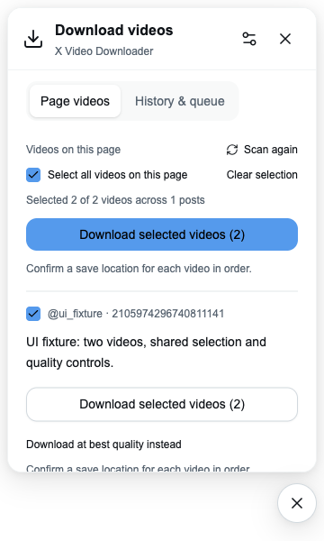
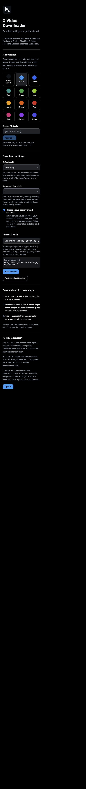

<p align="center">
  
</p>

<h1 align="center">X 视频下载器</h1>

<p align="center">
  <a href="./README.md">English</a> | 简体中文
</p>

<p align="center">
  <a href="https://chromewebstore.google.com/detail/x-video-downloader/jpialchpmmppdegagfhibhmpfaocjiep"></a>
  <a href="https://github.com/ntnyq/x-video-downloader/releases"></a>
  <a href="https://github.com/ntnyq/x-video-downloader/actions/workflows/ci.yml"></a>
  <a href="./LICENSE"></a>
</p>

<p align="center">
  将 X / Twitter 视频保存为 MP4，支持选择画质、批量下载和持久化下载队列。
</p>

## 📦 安装

[**从 Chrome 应用商店安装**][chrome-store] · 支持 Chrome、Edge 和其他 Chromium 浏览器（111+）

安装或更新后，请**刷新已打开的 X 页面**。

版本更新时，扩展会在新标签页打开更新日志。你也可以从 **设置 → 更新日志 → 查看更新日志** 打开。日志跟随浏览器语言，可离线查看。

## ✨ 功能

- **随手下载**。使用视频帖子下方的下载按钮、悬浮面板或工具栏弹窗。按 `Alt + O` 打开或关闭页面面板。
- **保存直播回放**。在直播页面或时间线卡片点击 **下载回放**，将受支持的回放保存为 MP4。
- **选择画质**。可选最高画质、优先 1080p 或 720p、节省空间，或逐个选择。以视频形式提供的 GIF 会保存为 MP4。
- **批量下载**。跨帖子选择视频，每批最多 100 个。
- **管理下载队列**。支持同时下载 1–6 个视频，默认 3 个。可查看进度、暂停、继续、取消和重试。
- **查找下载记录**。按文件名、帖子 ID 或作者搜索，按作者筛选，重复下载已完成的视频时会收到提醒。
- **自定义下载体验**。可调整文件名模板、保存位置提示、外观和悬浮按钮位置。界面跟随浏览器语言，支持英语、简体中文、繁体中文、日语和韩语。

## 🚀 快速开始

1. 打开 X 并等待视频加载，必要时先播放视频。
2. 单个下载时，点击帖子下方的 **下载最高画质**。
3. 批量下载时，打开 **选择视频**，勾选后点击 **下载所选视频**。
4. 要选择画质或管理下载，打开 **选择画质 / 进度**、页面上的 **下载视频** 悬浮按钮或工具栏弹窗。

文件默认保存到浏览器的下载文件夹。可在扩展设置中开启 **每次询问保存位置**。

<details>
<summary>选择、队列和下载记录</summary>

- **页面视频** 会同步页面、帖子和单个视频的勾选状态。从帖子打开面板时，列表只显示该帖的视频，点击 **查看全部** 即可展开。超过 100 个时，请减少本批的选择数量。
- 手动选择的画质适用于单个下载和批量下载。竖屏画质按短边计算。直播回放在独立标签页中选择画质。
- 后台重启后，等待中的任务会保留。暂停会释放下载名额，继续时会等待空闲名额。关闭面板或降低并发数时，正在进行的下载会继续。
- 在非 X 标签页也可以从工具栏弹窗查看 **下载记录**。其中的操作仅适用于本扩展创建的下载。
- **清理已结束** 会移除当前筛选结果中已结束的扩展记录及其重复下载提醒，同时保留文件、浏览器下载历史和仍在队列中、下载中或暂停的任务。也可以逐条移除已结束的记录。
- 即使画质或地址变化，重复下载提醒仍会根据帖子 ID 和视频顺序识别同一个视频。确认重复下载时，已经提交成功的新下载不会再次提交。并发点击会复用已经排队或正在运行的任务。

</details>

<details>
<summary>文件名和保存位置</summary>

文件名模板支持 `{author}`、`{date}`、`{postId}`、`{index}` 和 `{quality}`，可以即时预览并校验。

`{date}` 使用帖子的 UTC 日期。缺少作者或日期时，分别使用 `unknown` 和 `undated`。扩展会自动添加 `.mp4`，重名时由浏览器添加数字后缀。

可在浏览器设置中修改默认下载路径。开启保存位置提示后，保存对话框会依次打开，取消其中一个后下一个仍会出现。更新扩展时会保留已保存的偏好。

</details>

## 📸 界面预览

<details>
<summary>查看下载面板和设置</summary>

截图使用模拟页面和浏览器 API，展示下载面板和窄屏设置页的界面。





</details>

## 🔒 隐私和权限

使用扩展无需 API Key、后端或第三方视频解析服务。偏好和扩展下载记录保存在本地。直链下载只接受来自 `video.twimg.com` 的 HTTPS MP4。下载回放时，扩展会请求对应媒体主机的可选权限，获取 HLS 媒体并在本地打包。

详情见[隐私政策](docs/PRIVACY.md)。

<details>
<summary>权限和视频检测方式</summary>

| 权限或网站范围                                  | 用途                                       |
| ----------------------------------------------- | ------------------------------------------ |
| `downloads`                                     | 使用浏览器下载管理器保存所选的 MP4         |
| `storage`                                       | 保存偏好、文件名模板和扩展下载记录         |
| `activeTab`                                     | 在打开弹窗或使用快捷键时识别当前标签页     |
| `https://video.twimg.com/*`（可选）             | 获取 X 媒体 CDN 上的播放列表和分片         |
| `https://prod-fastly-p.video.pscp.tv/*`（可选） | 获取 Periscope 回放 CDN 上的播放列表和分片 |
| `https://*.x.com/*`、`https://*.twitter.com/*`  | 在 X / Twitter 检测视频并添加下载控件      |

捕获脚本观察 X 页面已经发起的 fetch 和 XHR 请求，从响应中提取视频画质信息。它不调用 X 私有 API，也不读取或转发认证令牌。扩展也可使用页面播放器公开的 MP4 直链。

隔离的内容脚本会校验捕获记录，并将 Vue 界面挂载在 Shadow DOM 内。后台脚本在调用浏览器下载 API 前，会再次校验发送方、帖子 ID 和下载地址。

已检测的视频保存在当前页面内存中，最多缓存 250 条帖子。本地存储保留偏好、悬浮按钮位置、最近 200 条已结束的下载记录，以及最多 1,000 条等待、暂停或运行中的任务。下载记录包含视频地址、文件名和帖子元数据，以便恢复进度和重试。扩展仅访问和显示自身创建的下载。

打开面板时，每秒查询一次下载进度。总大小未知时，界面仅显示已下载的字节数。

</details>

## 💡 常见问题

**没找到视频？** 先播放视频，再点击 **重新检测**。如果仍未发现视频，请刷新 X 页面，让扩展捕获新的响应。

**怎么下载直播回放？** 在 X 直播页面等待播放器加载，再打开下载面板或弹窗，点击 **下载回放**。如果没有显示回放，请刷新 X 并尝试开始播放。支持来自 `video.twimg.com` 或 `prod-fastly-p.video.pscp.tv`、已结束且未加密的 H.264/AAC 回放，容器格式为 fMP4 或 MPEG-TS。扩展会根据浏览器报告的存储配额限制临时文件大小。请保持回放任务标签页打开，直到浏览器保存 MP4。

<details>
<summary>更多限制和恢复方式</summary>

- `blob:` 地址由播放器生成。扩展会在页面响应中查找原始 MP4。
- 下载受限帖子的前提是已经正常登录 X 且有权查看该帖子。
- X 变更响应格式或页面结构时，扩展可能需要更新解析逻辑或选择器。
- 重试会使用原视频地址。地址失效时，请刷新原帖并重新检测。
- 已暂停的任务可以在面板中继续或取消。
- 如果后台在浏览器接收下载任务时停止，任务会以 `START_INTERRUPTED` 结束。重试前请先检查浏览器的下载列表，以免重复下载。
- [HLS 可行性说明](docs/hls-feasibility.md)记录了最初的格式和浏览器兼容性评估。

</details>

## 🛠️ 开发

技术栈为 **WXT + Vue 3 + TypeScript + Tailwind CSS + shadcn-vue**。

<details>
<summary>从源码构建 · Chrome / Edge 和 Firefox</summary>

请使用 Node.js LTS 和 `package.json` 中指定的 pnpm 版本。

```sh
pnpm install
pnpm build
```

在 **Chrome / Edge** 的扩展页面开启 **开发者模式**，选择 **加载已解压的扩展程序**，然后选择 `dist/chrome-mv3`。

使用 **Firefox 140+** 时，运行 `pnpm build:firefox`，再到 `about:debugging#/runtime/this-firefox` 加载 `dist/firefox-mv3/manifest.json`。临时扩展在 Firefox 重启后会移除，永久安装需要 Mozilla 签名。

修改源码后，重新构建并重新加载扩展，然后刷新 X 页面。如果下载按钮重复出现，请禁用其他版本的扩展。

运行 `pnpm zip` 或 `pnpm zip:firefox` 可在 `dist/` 下生成分发包。

</details>

<details>
<summary>开发命令和检查</summary>

请使用 Node.js LTS 和 `package.json` 中指定的 pnpm 版本。

```sh
pnpm install
pnpm dev
pnpm dev:firefox
```

提交改动前请运行以下检查。

```sh
pnpm test
pnpm format:check
pnpm lint
pnpm typecheck
pnpm build
pnpm build:firefox
```

测试使用 `node:test`、`node:assert/strict` 和 `tsx`，覆盖视频捕获与解析、URL 和消息校验、队列恢复、并发、批量下载、重复下载提醒、记录清理、文件名校验、本地化及下载生命周期。

改动界面时，请验证窄屏下的弹窗和页面内交互。记录验证结果时，请区分模拟浏览器检查、登录 X 后的实际下载以及 Firefox 实际运行。

</details>

<details>
<summary>翻译和共享资源</summary>

翻译位于 `locales/`，包括 `en`、`zh_CN`、`zh_TW`、`ja` 和 `ko`。扩展跟随浏览器语言，默认回退至英语。更改浏览器界面语言后，请重新打开扩展页面并刷新 X。

添加语言时，请复制 `locales/en.yaml`，保留所有键和 `$1` 等占位符，并原样保留文件名模板变量。测试会检查翻译键、占位符、页面语言声明和错误消息的完整性。浏览器错误代码会保留，便于排查问题。

图标源文件是 `assets/images/downloader.svg`，WXT 会生成不同尺寸的 PNG。通用工具使用 `@ntnyq/utils`，视频来源和下载请求由项目自己的校验函数处理。

</details>

<details>
<summary>维护更新日志</summary>

AI 辅助提交按 `AGENTS.md` 的要求使用项目内的 [prepare-changelog 技能](.agents/skills/prepare-changelog/SKILL.md)。面向用户的改动记录在 `docs/changelog/unreleased.yaml`，包含五种语言的翻译和来源依据。纯内部改动可跳过。由 AI 助手执行这一流程，手动运行 `git commit` 不会调用 AI 服务。

也可以显式调用 `$prepare-changelog`，根据当前改动、提交范围或发布标签准备日志。例如「使用 $prepare-changelog 根据 v0.0.2 到 v0.0.3 生成更新日志」。补写历史日志时保留其他版本，待发布的条目在准备发布时才会分配版本号。

翻译使用嵌套的 YAML 命名空间，例如 `theme.title`、`filename.template` 和 `download.state.queued`。请保持五份语言文件的结构与占位符一致，通过 `i18n.t('theme.title')` 等方式访问。WXT 会生成带类型的点分键，并将浏览器消息键转换为以下划线连接的形式，因此清单文件使用 `__MSG_extension_name__` 等引用。

发布前，在 `constants/changelog.ts` 顶部添加发布日期和变更，并在五个 `locales/*.yaml` 文件中添加对应的 `changelog.releases.<version>.*` 消息。版本与 `package.json` 一致，按新版本在前排列，说明用户可见的变更。测试会检查最新条目的版本和所有变更的翻译。

更新日志随扩展打包，可以离线查看。首次安装打开欢迎页，版本更新打开 `changelog.html`。WXT 开发更新、同版本重新加载或单独更新浏览器时，扩展不会自动打开更新日志。

</details>

## 📄 许可证

[MIT](./LICENSE) © 2026 至今 [ntnyq](https://github.com/ntnyq)

[chrome-store]: https://chromewebstore.google.com/detail/x-video-downloader/jpialchpmmppdegagfhibhmpfaocjiep
